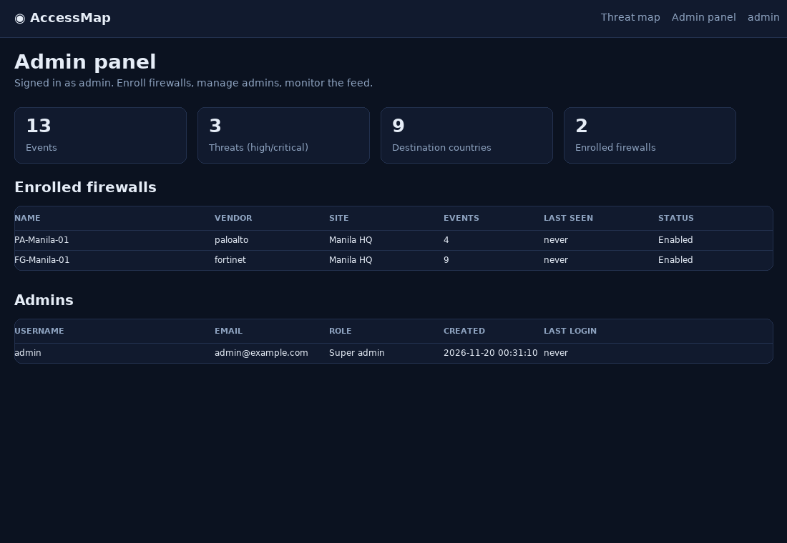
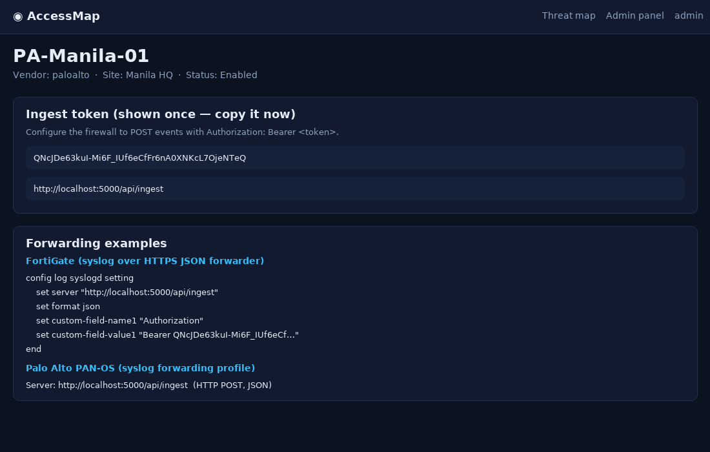

# AccessMap

A **FortiGuard-style live threat map** for Fortinet FortiGate and Palo Alto
PAN-OS firewalls. Enrolled firewalls stream the websites their end users
visit; AccessMap resolves the **source and destination IP locations** and
draws source → destination arcs on a world map, colour-coded by threat level.


## Features

- **Live threat map** (`/`) — Leaflet world map with source → destination
  arcs, threat-level colours, firewall/threat filters, IP search, and a
  recent-visits table that auto-refreshes every 15 s.
- **Admin panel** (`/admin/`) — **one-time admin registration** (the public
  `/register` page closes forever once the first admin exists), then admins
  can **enroll firewalls** (Fortinet / Palo Alto / Other), **add more
  admins**, rotate ingest tokens, enable/disable firewalls, and change
  passwords.
- **Firewall ingest** (`POST /api/ingest`) — accepts JSON batches and
  FortiGate/PAN-OS syslog text, normalizes vendor fields, geo-resolves
  both IPs, and threat-scores every event.
- **Geo resolution** — cache → online lookup (ip-api.com) → deterministic
  offline fallback, so the map renders even in air-gapped deployments.
- **Threat scoring** — transparent rule-based scoring (blocked sessions,
  suspicious ports, high-abuse TLDs, large transfers) with attributable reasons.
- **One-time Ubuntu installer** — `install.sh` installs all prerequisites,
  creates the service user, systemd unit, firewall rules and nginx proxy,
  then health-checks the app.
- **Clean code** — small modules with single responsibilities, type hints,
  parameterized SQL everywhere, and a 34-test pytest suite.

## Screenshots

| Threat map | Admin dashboard |
|---|---|
|  |  |

| Firewall detail (token + forwarding examples) | Sign in |
|---|---|
|  |  |

> Screenshots are rendered from real seeded application data by
> `scripts/capture_screenshots.py` (no browser needed).

## Quick start

### Option A — Ubuntu installer (recommended)

```bash
git clone https://github.com/mikeehendricks/AccessMap.git
cd AccessMap
sudo ./install.sh --seed        # --seed loads demo firewalls + events
```

Then open `http://<server>:5000/`, visit `/register` **once** to create
the first admin, and sign in at `/admin/`.

Useful flags: `--no-nginx` (skip the reverse proxy), `--port 5000`.

### Option B — Run manually (dev)

```bash
python3 -m venv .venv
.venv/bin/pip install -r requirements.txt
cp .env.example .env            # set a real SECRET_KEY
.venv/bin/python app.py         # http://127.0.0.1:5000
.venv/bin/python -m accessmap.seed   # optional demo data
```

## Connecting a firewall

1. Sign in → **Admin panel → + Enroll firewall** (name, vendor, site).
2. Copy the **ingest token** (shown once) and endpoint
   `POST /api/ingest` with header `Authorization: Bearer <token>`.
3. Configure the firewall to forward events. The firewall detail page
   shows ready-made FortiGate and PAN-OS examples; the generic JSON
   format is:

```json
{"events": [{
  "src_ip": "10.0.0.5", "dst_ip": "203.0.113.10",
  "dst_domain": "news.example.com", "dst_port": 443,
  "protocol": "tcp", "action": "allow", "bytes_out": 1234,
  "user_name": "jdelacruz"
}]}
```

Plain-text syslog is also accepted (`Content-Type: text/plain`) with
FortiGate `srcip=/dstip=/dstport=/dsthost=` or PAN-OS
`SRC=/DST=/DPORT=/HOST=` tokens. Vendor aliases (`src`, `dst`,
`dport`, `service`, …) are mapped automatically.

## API reference

| Method | Path | Auth | Description |
|---|---|---|---|
| `GET` | `/api/health` | — | Liveness probe |
| `GET` | `/api/events?limit=&firewall_id=&threat=` | — | Recent events with geo coords |
| `GET` | `/api/stats` | — | Aggregate counters |
| `GET` | `/api/firewalls` | — | Enrolled firewalls (no tokens) |
| `GET` | `/api/geo?ip=` | — | Resolve one IP to a location |
| `POST` | `/api/ingest` | `Bearer <token>` | Ingest events from a firewall |

## Project structure

```
app.py                  Flask app factory + entry point
accessmap/
  config.py             Environment-driven configuration
  db.py                 SQLite data-access layer (parameterized queries)
  auth.py               PBKDF2 hashing, sessions, CSRF, login throttle
  geo.py                IP → location (cache → online → offline fallback)
  ingest.py             FortiGate / PAN-OS / JSON log normalization
  threat.py             Rule-based threat scoring
  seed.py               Demo-data seeder
  routes/               auth, admin, API, ingest blueprints
  templates/            Jinja templates (map, login, register, admin)
  static/               CSS + Leaflet map JS
install.sh              One-time Ubuntu installer
deploy/                 systemd unit + nginx reverse-proxy config
tests/                  34 pytest tests (auth, ingest, geo, security, usability)
docs/TESTING.md         Usability / bug / vulnerability test report
scripts/capture_screenshots.py   Regenerate README screenshots
```

## Security notes

- Passwords: PBKDF2-HMAC-SHA256 with per-password salts (260k iterations).
- Sessions: HttpOnly + SameSite=Lax cookies; CSRF token on every form;
  login throttling with lockout; constant-time token comparisons.
- All SQL is parameterized; templates auto-escape output; security
  headers (CSP, nosniff, SAMEORIGIN) are set on every response.
- Ingest tokens are never exposed via the API and can be rotated or
  disabled per firewall.
- Set `COOKIE_SECURE=1` and serve over HTTPS in production (the
  installer + nginx + certbot path in `deploy/` does this).

See [docs/TESTING.md](docs/TESTING.md) for the full usability, bug and
vulnerability test report.

## License

MIT — see the repository for details.
