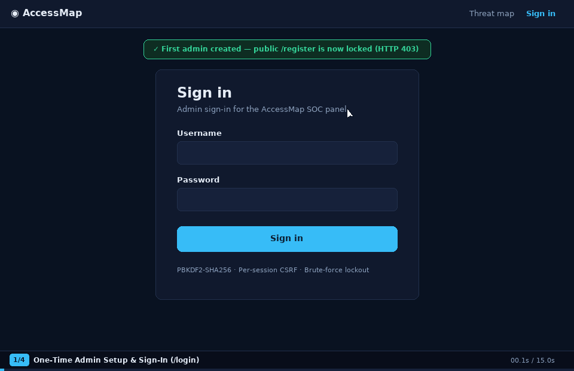
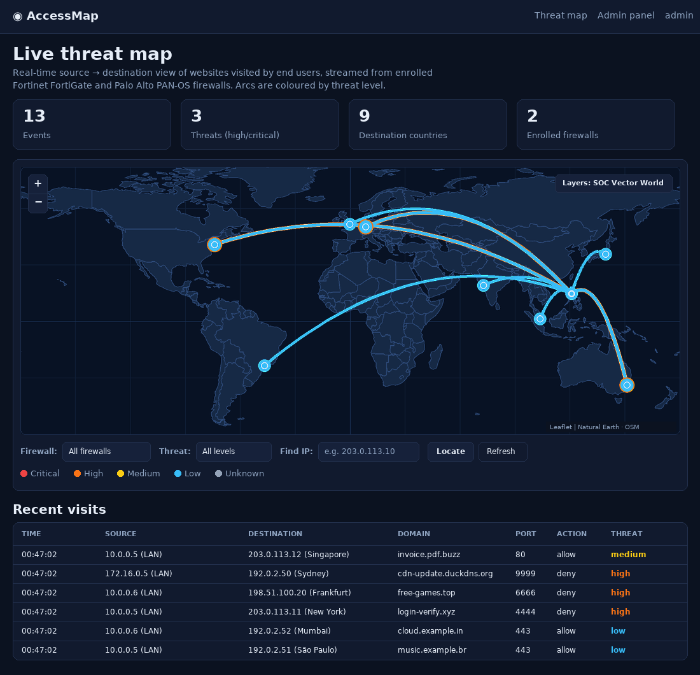
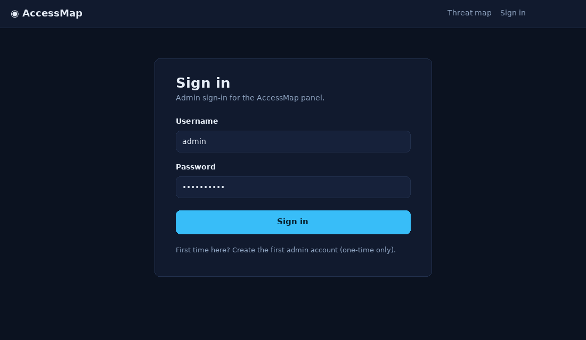

# AccessMap

A **FortiGuard-style live threat map** for Fortinet FortiGate and Palo Alto
PAN-OS firewalls. Enrolled firewalls stream the websites their end users
visit; AccessMap resolves the **source and destination IP locations** and
draws source → destination arcs on a world map, colour-coded by threat level.

## How it works (15-second walkthrough)



1. **`0.0s – 3.0s` · One-Time Admin Setup & Sign-In** — The first admin registers once (`/register` then locks permanently with `HTTP 403`) and signs in to the SOC panel.
2. **`3.0s – 6.5s` · Enroll Fortinet & Palo Alto Firewalls** — Admins enroll FortiGate and PAN-OS appliances, copy their Bearer ingest token, and point syslog/HTTPS forwarders to `POST /api/ingest`.
3. **`6.5s – 12.5s` · Live Stream & World Threat Map** — AccessMap geo-resolves source and destination IPs, scores threats, and plots curved trajectories across the world map alongside the live visits feed.
4. **`12.5s – 15.0s` · Filter Threats & Locate Any IP** — Analysts filter down to High/Critical events and jump directly to any IP's resolved location on the map.

## Features

- **Live threat map** (`/`) — Leaflet world map with curved source → destination
  arcs, threat-level colours, firewall/threat filters, IP search, and a
  recent-visits table that auto-refreshes every 15 s. Both Leaflet and a
  **Natural Earth 110m vector world map** (`static/vendor/`) are
  self-hosted, so the continents and country borders render immediately
  even offline or in air-gapped networks, with optional CARTO Dark Matter
  and OpenStreetMap tile basemaps available via the layer switcher when online.
- **Admin panel** (`/admin/`) — **one-time admin registration** (the public
  `/register` page closes forever once the first admin exists), then admins
  can **enroll firewalls** (Fortinet / Palo Alto / Other), **add more
  admins**, rotate ingest tokens, enable/disable firewalls, and change
  passwords.
- **Firewall ingest** (`POST /api/ingest`) — accepts JSON batches and
  FortiGate/PAN-OS syslog text, normalizes vendor fields, geo-resolves
  both IPs, and threat-scores every event.
- **Geo resolution** — cache → online lookup (ip-api.com) → deterministic
  offline fallback, so the map renders even in air-gapped deployments.
- **Threat scoring** — transparent rule-based scoring (blocked sessions,
  suspicious ports, high-abuse TLDs, large transfers) with attributable reasons.
- **One-time Ubuntu installer** — `install.sh` installs all prerequisites,
  creates the service user, systemd unit, firewall rules and nginx proxy,
  then health-checks the app.
- **Clean code** — small modules with single responsibilities, type hints,
  parameterized SQL everywhere, and a 43-test pytest suite.

## Screenshots

| Threat map | Admin dashboard |
|---|---|
|  |  |

| Firewall detail (token + forwarding examples) | Sign in |
|---|---|
|  |  |

> Screenshots and the 15-second walkthrough GIF are rendered from real
> seeded application data by `scripts/capture_screenshots.py` and
> `scripts/generate_demo_gif.py` (no browser needed).

## Quick start

### Option A — Ubuntu installer (recommended)

```bash
git clone https://github.com/mikeehendricks/AccessMap.git
cd AccessMap
sudo ./install.sh --seed        # --seed loads demo firewalls + events
```

Then open `http://<server>:5000/`, visit `/register` **once** to create
the first admin, and sign in at `/admin/`.

Useful flags: `--no-nginx` (skip the reverse proxy), `--port 5000`.

### Option B — Run manually (dev)

```bash
python3 -m venv .venv
.venv/bin/pip install -r requirements.txt
cp .env.example .env            # set a real SECRET_KEY
.venv/bin/python app.py         # http://127.0.0.1:5000
.venv/bin/python -m accessmap.seed   # optional demo data
```

## Connecting a firewall

1. Sign in → **Admin panel → + Enroll firewall** (name, vendor, site).
2. Copy the **ingest token** (shown once) and endpoint
   `POST /api/ingest` with header `Authorization: Bearer <token>`.
3. Configure the firewall to forward events. The firewall detail page
   shows ready-made FortiGate and PAN-OS examples; the generic JSON
   format is:

```json
{"events": [{
  "src_ip": "10.0.0.5", "dst_ip": "203.0.113.10",
  "dst_domain": "news.example.com", "dst_port": 443,
  "protocol": "tcp", "action": "allow", "bytes_out": 1234,
  "user_name": "jdelacruz"
}]}
```

Plain-text syslog is also accepted (`Content-Type: text/plain`) with
FortiGate `srcip=/dstip=/dstport=/dsthost=` or PAN-OS
`SRC=/DST=/DPORT=/HOST=` tokens. Vendor aliases (`src`, `dst`,
`dport`, `service`, …) are mapped automatically.

## API reference

| Method | Path | Auth | Description |
|---|---|---|---|
| `GET` | `/api/health` | — | Liveness probe |
| `GET` | `/api/events?limit=&firewall_id=&threat=` | — | Recent events with geo coords |
| `GET` | `/api/stats` | — | Aggregate counters |
| `GET` | `/api/firewalls` | — | Enrolled firewalls (no tokens) |
| `GET` | `/api/geo?ip=` | — | Resolve one IP to a location |
| `POST` | `/api/ingest` | `Bearer <token>` | Ingest events from a firewall |

## Project structure

```
app.py                  Flask app factory + entry point
accessmap/
  config.py             Environment-driven configuration
  db.py                 SQLite data-access layer (parameterized queries)
  auth.py               PBKDF2 hashing, sessions, CSRF, login throttle
  geo.py                IP → location (cache → online → offline fallback)
  ingest.py             FortiGate / PAN-OS / JSON log normalization
  threat.py             Rule-based threat scoring
  seed.py               Demo-data seeder
  routes/               auth, admin, API, ingest blueprints
  templates/            Jinja templates (map, login, register, admin)
  static/               CSS + map JS + vendored Leaflet & Natural Earth world GeoJSON
install.sh              One-time Ubuntu installer
deploy/                 systemd unit + nginx reverse-proxy config
tests/                  43 pytest tests (auth, ingest, geo, security audit, usability)
docs/TESTING.md         Usability / bug / vulnerability test report
docs/SECURITY_AUDIT_REPORT.md   Executive security vulnerability report & fixes
scripts/capture_screenshots.py   Regenerate README screenshots
scripts/generate_demo_gif.py     Regenerate 15-second README walkthrough GIF
```

## Security notes

- Passwords: PBKDF2-HMAC-SHA256 with per-password salts (260k iterations)
  and timing-equalized login checks; password changes immediately revoke
  other active sessions.
- Sessions: HttpOnly + SameSite=Lax cookies; CSRF token on every form;
  `(client_ip, username)` login throttling; super-admin RBAC for admin creation.
- Firewall ingest tokens: **SHA-256 hashed at rest**, displayed strictly
  once upon enrollment/rotation, and accepted only via `Authorization: Bearer`.
- Public privacy: unauthenticated `/api/events` and `/api/firewalls`
  mask internal RFC1918 LAN IPs, strip usernames, and omit appliance FQDNs.
- All SQL is parameterized; templates auto-escape output; security
  headers (CSP, nosniff, SAMEORIGIN, strict-origin-when-cross-origin,
  Permissions-Policy, `Cache-Control: no-store` on admin/auth) are set.
- Set `COOKIE_SECURE=1` and serve over HTTPS in production (the
  installer + Gunicorn + nginx + certbot path in `deploy/` does this).

See [docs/SECURITY_AUDIT_REPORT.md](docs/SECURITY_AUDIT_REPORT.md) for the
full executive vulnerability assessment and [docs/TESTING.md](docs/TESTING.md)
for the usability, bug and vulnerability test report.

## License

MIT — see the repository for details.
